<div align="center">


<br/>


<br/><br/>

**Profil + ton + objectifs → publications LinkedIn, Facebook et Instagram → validation → publication**

*Projet de stage d'été réaliser par [Siwar Mrayhi](https://github.com/siwarmrayhi).* au sein de 3LM Solutions

</div>

<br/>


---

## 📌 Vue d'ensemble

**Community Manager Virtuel IA** est une application web d'assistant community manager propulsé par l'IA, conçue pour la plateforme **Tunisia Invest**.

Elle génère automatiquement des publications pour les réseaux sociaux (**LinkedIn, Facebook, Instagram**) à partir du **profil**, du **ton** et des **objectifs** de l'utilisateur, puis les soumet à **validation** avant publication.

> L'accès au service se fait par **abonnement mensuel**, payé via **PayPal**.

## 🎬 Démonstration vidéo

<div align="center">

<!-- Remplacez VOTRE_LIEN_GOOGLE_DRIVE par le lien de votre vidéo -->
<a href="VOTRE_LIEN_GOOGLE_DRIVE">
  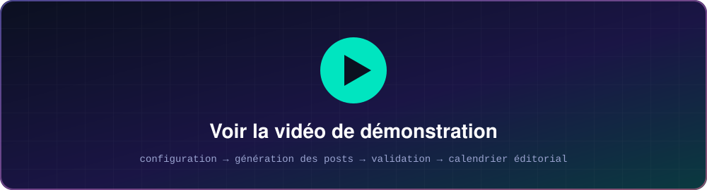
</a>

</div>

## 📸 Aperçu de l'application

<table>
  <tr>
    <td align="center" colspan="2">
      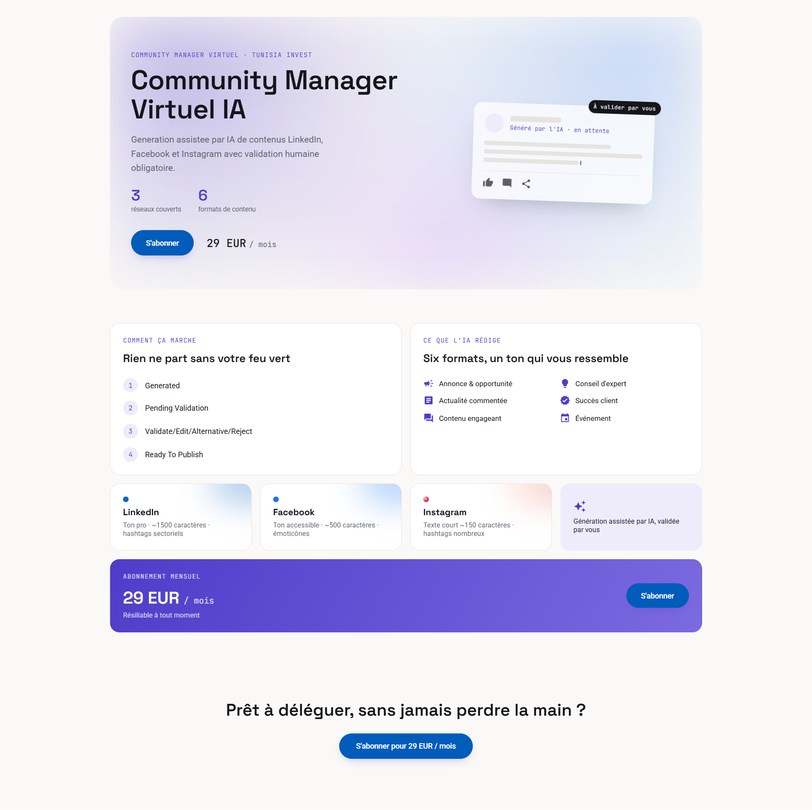<br/>
      <b>Page d'accueil</b><br/>
      <sub>Présentation du service de community manager virtuel.</sub>
    </td>
  </tr>
  <tr>
    <td align="center" width="50%" valign="top">
      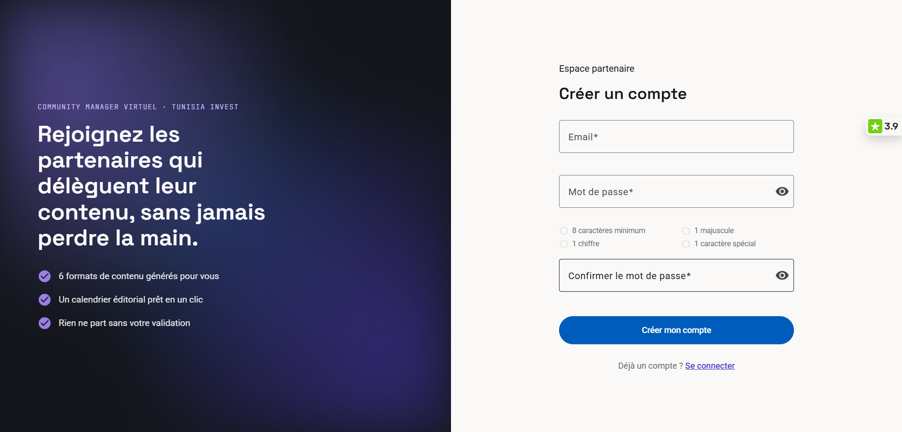<br/>
      <b>Authentification</b><br/>
      <sub>Connexion et inscription sécurisées par JWT.</sub>
    </td>
    <td align="center" width="50%" valign="top">
      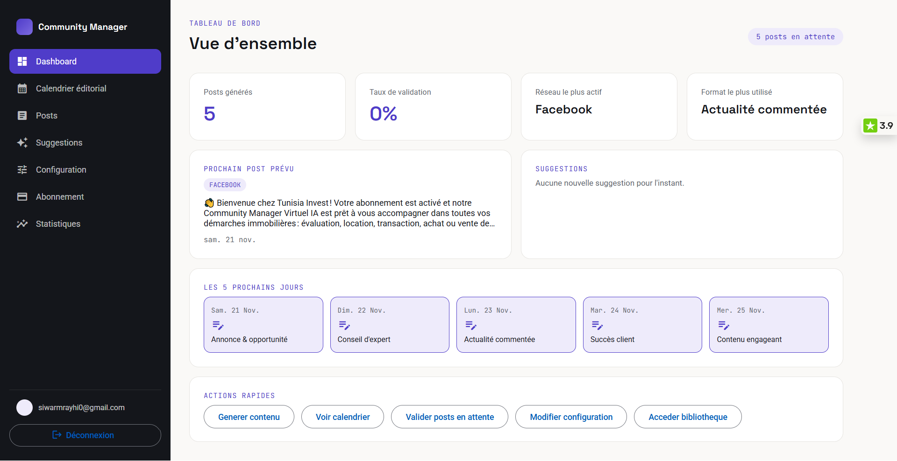<br/>
      <b>Dashboard</b><br/>
      <sub>Tableau de bord et statistiques d'activité.</sub>
    </td>
  </tr>
  <tr>
    <td align="center" valign="top">
      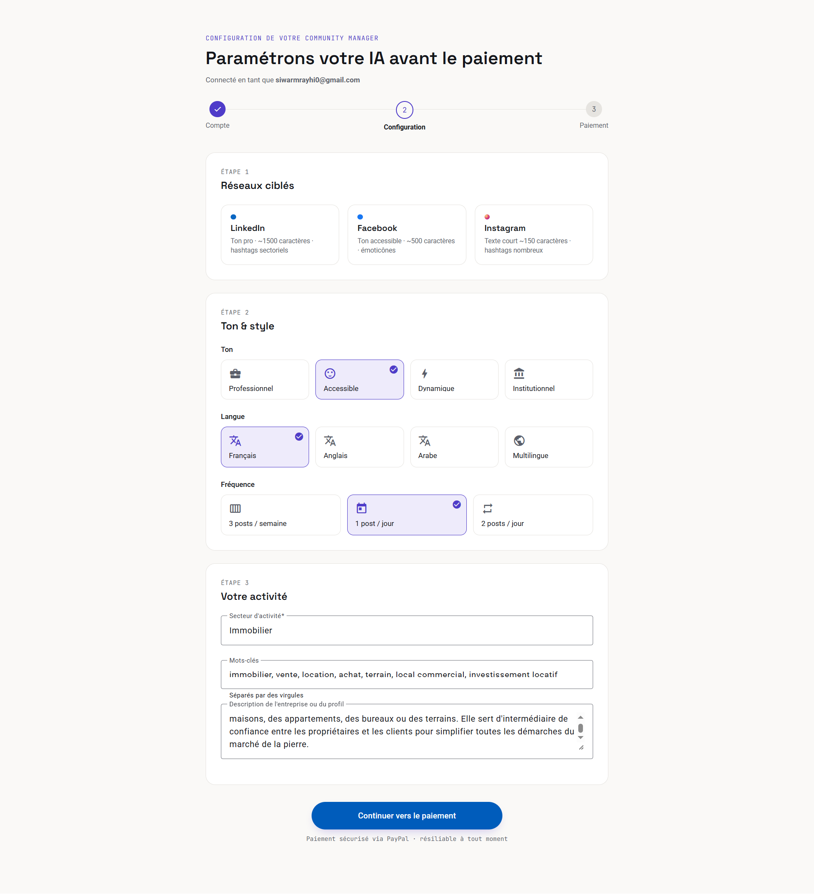<br/>
      <b>Configuration</b><br/>
      <sub>Réseaux ciblés, ton, langue, fréquence, secteur et mots-clés.</sub>
    </td>
    <td align="center" valign="top">
      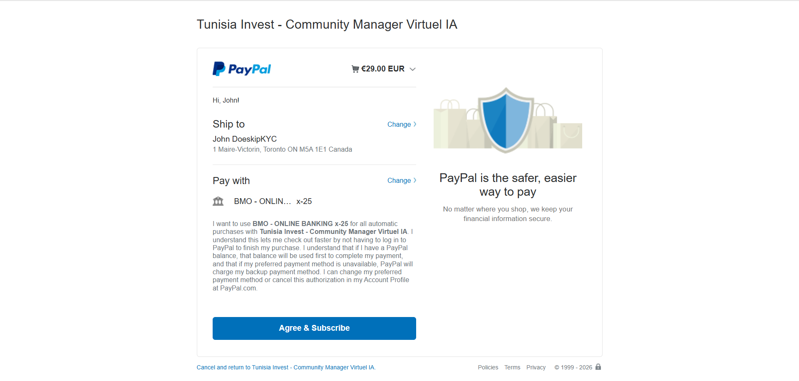<br/>
      <b>Abonnement PayPal</b><br/>
      <sub>Souscription, confirmation et résiliation de l'abonnement mensuel.</sub>
    </td>
  </tr>
  <tr>
    <td align="center" valign="top">
      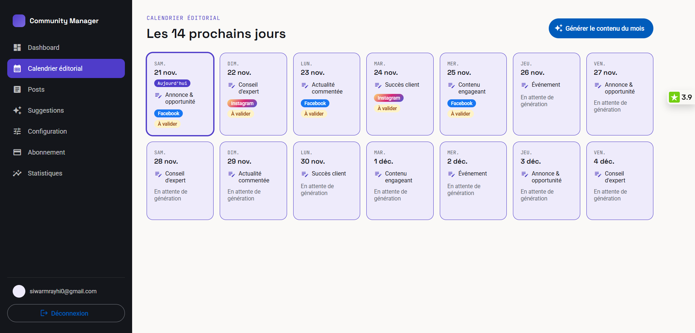<br/>
      <b>Calendrier éditorial</b><br/>
      <sub>Publications planifiées, jour après jour.</sub>
    </td>
    <td align="center" valign="top">
      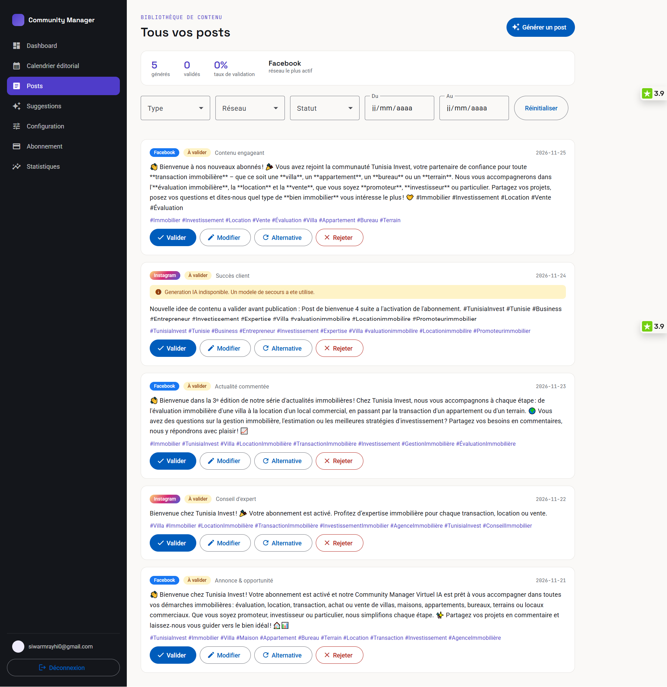<br/>
      <b>Génération de publications</b><br/>
      <sub>Contenu généré par l'IA, adapté à chaque réseau social.</sub>
    </td>
  </tr>
</table>

## 📑 Sommaire

- [Fonctionnalités](#-fonctionnalités)
- [Options de configuration](#-options-de-configuration)
- [Architecture](#-architecture)
- [Structure du projet](#-structure-du-projet)
- [Modèle de données](#-modèle-de-données)
- [Génération de contenu (Groq)](#-génération-de-contenu-groq)
- [API REST](#-api-rest)
- [Lancement](#-lancement)
- [Technologies utilisées](#-technologies-utilisées)

---

## ✨ Fonctionnalités

| | Fonctionnalité | Ce qu'elle apporte |
|:-:|---|---|
| 🔐 | **Compte sécurisé** | Inscription et connexion par JWT, avec pages de connexion, d'inscription et de mot de passe oublié. |
| 💳 | **Abonnement mensuel PayPal** | Souscription, confirmation et résiliation. |
| 🎛️ | **Configuration du community manager** | Réseaux ciblés, ton, langue, fréquence de publication, secteur d'activité, mots-clés et description du profil. |
| 🤖 | **Génération par IA** | Publications adaptées à chaque réseau social. |
| 📅 | **Calendrier éditorial** | Vue des publications planifiées. |
| 📚 | **Bibliothèque de posts** | Filtres par type, réseau, période et statut. |
| ✅ | **Validation des posts** | Valider, modifier ou rejeter un post, avec génération d'une version alternative. |
| 💡 | **Suggestions de contenu** | Idées basées sur des annonces, des événements ou d'autres informations métier. |
| 📊 | **Tableau de bord** | Statistiques d'activité. |

### Cycle de vie d'un post

<div align="center">
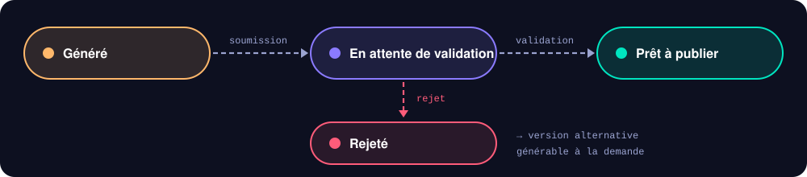
</div>

---

## 🔧 Options de configuration

| Paramètre | Valeurs possibles |
|---|---|
| **Réseaux** | LinkedIn, Facebook, Instagram |
| **Ton** | Professionnel, Accessible, Dynamique, Institutionnel |
| **Langue** | Français, Anglais, Arabe, Multilingue |
| **Fréquence** | 3 posts par semaine, 1 post par jour, 2 posts par jour |
| **Types de contenu** | Promotion d'annonce, Conseil d'expert, Commentaire d'actualité sectorielle, Témoignage client, Contenu engageant, Promotion d'événement |
| **Statuts d'un post** | Généré, En attente de validation, Prêt à publier, Rejeté |

---

## 🧱 Architecture

<div align="center">
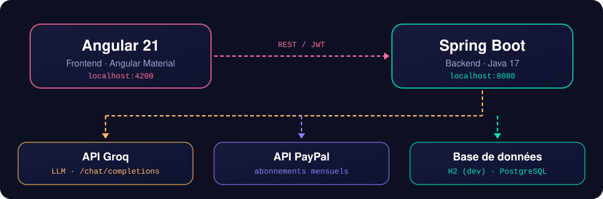
</div>

Le frontend Angular dialogue avec le backend Spring Boot en **REST**, authentifié par **JWT**. Le backend est le seul à appeler les services externes (API Groq pour la génération, API PayPal pour les abonnements) et à accéder à la base de données.

---

## 📁 Structure du projet

```text
Community-Manager-Virtual-IA/
├── backend/                              API Spring Boot (Java 17)
│   ├── pom.xml
│   └── src/main/java/tn/tunisiainvest/cm/
│       ├── config/                       CORS, clients Groq et PayPal, propriétés
│       ├── controller/                   Contrôleurs REST (/api/auth, /api/cm)
│       ├── dto/                          Objets de requête et de réponse
│       ├── model/                        Entités JPA et énumérations
│       ├── repository/                   Repositories Spring Data JPA
│       ├── security/                     Authentification JWT et configuration de sécurité
│       └── service/                      Logique métier, intégration Groq et PayPal
└── community-manager-frontend/           Application Angular 21
    └── src/app/
        ├── core/                         Services, guards, intercepteurs, modèles
        ├── features/                     Pages (landing, auth, dashboard, calendrier,
        │                                 posts, suggestions, configuration, abonnement,
        │                                 statistiques)
        ├── layout/                       Structure principale de l'application
        └── shared/                       Composants réutilisables
```

---

## 💾 Modèle de données

| Entité | Rôle |
|---|---|
| **User** | Compte utilisateur. |
| **Subscription** | État de l'abonnement mensuel PayPal. |
| **CMConfiguration** | Paramètres d'activation : réseaux, ton, langue, fréquence, secteur, mots-clés, description du profil. |
| **Post** | Contenu généré, en attente de validation, prêt à publier ou rejeté. |
| **Suggestion** | Idée de contenu issue d'une annonce, d'un événement ou d'un autre besoin métier. |

---

## 🧠 Génération de contenu (Groq)

- `GroqContentService` construit un **prompt adapté à chaque réseau** à partir de la configuration de l'utilisateur et du contexte de génération.
- Les appels utilisent **WebClient** vers l'endpoint `/chat/completions` de l'API Groq (modèle par défaut : `llama-3.3-70b-versatile`).
- **Mode dégradé** : si la clé API est absente, si Groq est indisponible ou si la réponse est inutilisable, le service renvoie un **modèle de publication de secours** accompagné d'un message d'information pour l'utilisateur.

---

## 🔌 API REST

### Authentification (`/api/auth`)

| Méthode | Endpoint | Description |
|:-:|---|---|
| `POST` | `/api/auth/register` | Création de compte |
| `POST` | `/api/auth/login` | Connexion (retourne un JWT) |

### Community manager (`/api/cm`)

| Méthode | Endpoint | Description |
|:-:|---|---|
| `GET` | `/api/cm/service` | Description du service |
| `POST` | `/api/cm/abonnement` | Initier un abonnement |
| `POST` | `/api/cm/abonnement/confirmer` | Confirmer l'abonnement PayPal |
| `DELETE` | `/api/cm/abonnement` | Résilier l'abonnement |
| `PUT` | `/api/cm/configuration` | Mettre à jour la configuration |
| `GET` | `/api/cm/calendrier` | Calendrier éditorial |
| `POST` | `/api/cm/generer` | Générer du contenu |
| `GET` | `/api/cm/posts` | Lister les posts (filtres : type, réseau, dates, statut) |
| `PATCH` | `/api/cm/posts/{id}/valider` | Valider un post |
| `PATCH` | `/api/cm/posts/{id}/modifier` | Modifier un post |
| `POST` | `/api/cm/posts/{id}/alternative` | Générer une version alternative |
| `DELETE` | `/api/cm/posts/{id}` | Supprimer un post |
| `GET` | `/api/cm/suggestions` | Suggestions de contenu |
| `GET` | `/api/cm/statistiques` | Statistiques |

---

## 🚀 Lancement

Le backend tourne sur `http://localhost:8080` et le frontend sur `http://localhost:4200`.

```bash
git clone https://github.com/siwarmrayhi/Community-Manager-Virtual-IA.git
cd Community-Manager-Virtual-IA
```

**Backend** (Java 17 et Maven) :

```bash
cd backend
mvn spring-boot:run
```

**Frontend** (Node.js et Angular CLI) :

```bash
cd community-manager-frontend
npm install
ng serve
```

> 💡 En développement, la base **H2** est utilisée. La génération de contenu nécessite une clé API Groq ; sans elle, l'application renvoie un modèle de publication de secours. L'abonnement nécessite la configuration des identifiants PayPal côté backend.

---

## 🧰 Technologies utilisées

<div align="center">
</div>

---

<div align="center">

## 👩‍💻 Auteure

**Siwar Mrayhi**

<a href="https://github.com/siwarmrayhi"></a>
<a href="https://linkedin.com/in/siwar-mrayhi"></a>

</div>
